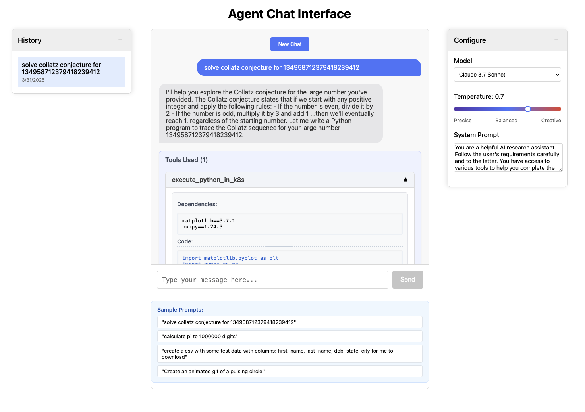
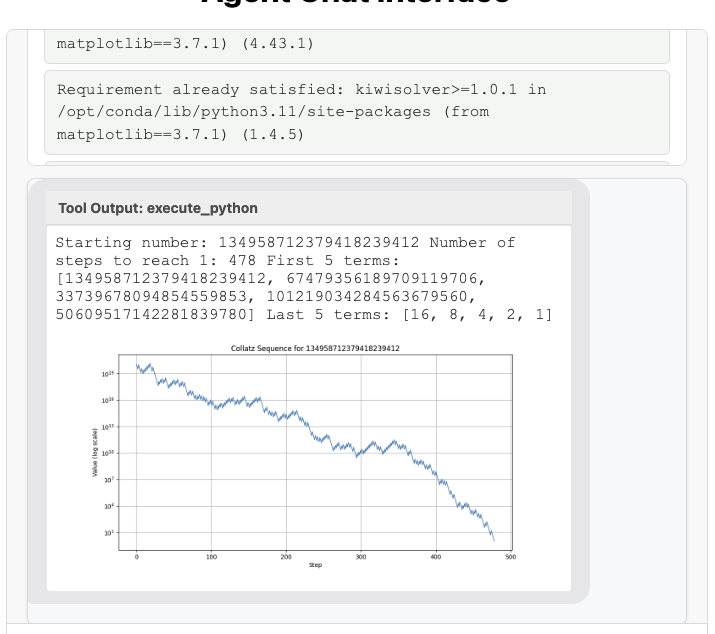
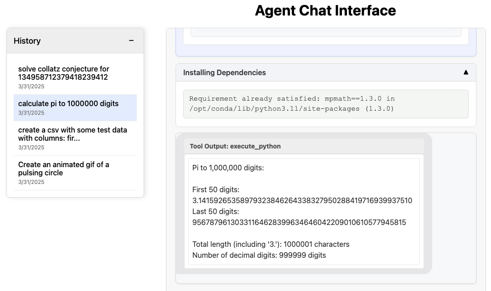
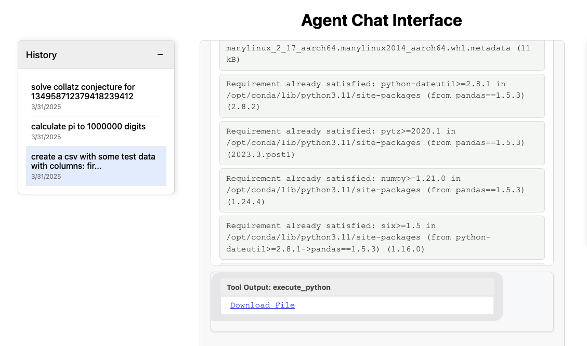
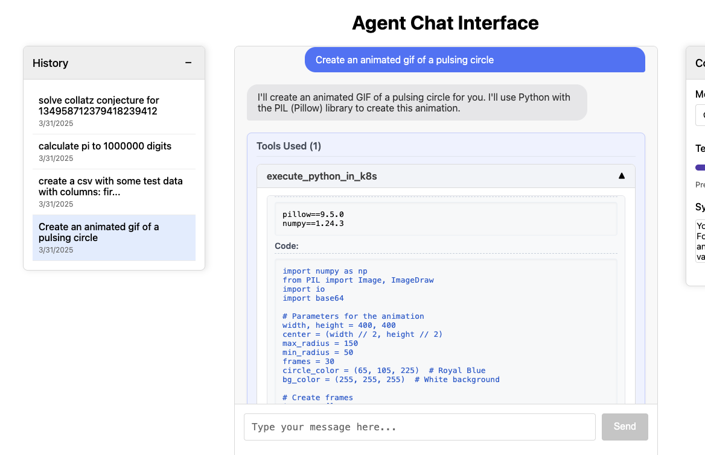
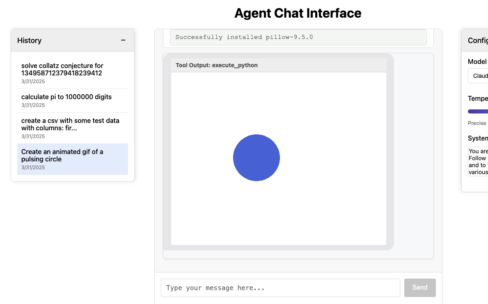
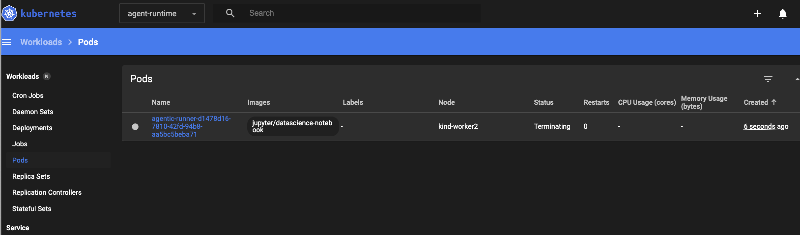

# Kubernetes Agent Prototype
An AI agent that writes code to execute in a Kubernetes cluster using a kubernetes tool.

The [frontent](frontend) was "*vibe coded*" with [Claude Code](https://docs.anthropic.com/en/docs/agents-and-tools/claude-code/overview)

## Prerequisites
* install python ^3.11
* [poetry](https://python-poetry.org/)
* [kubectl](https://kubernetes.io/docs/reference/kubectl/)
* [kubectx and kubens](https://formulae.brew.sh/formula/kubectx)
* [docker](https://www.docker.com/) - for running locally
* [kind](https://kind.sigs.k8s.io/) - for a local k8s cluster

## Getting started
**If you have a kubernetes cluster:**
1. sign in and use `kubectx` to set the kube context to that cluster. 
2. Create a `agent-runtime` namespace to isolate pods created by this project

**If you do not have a kuberenets cluster:**
1. start docker
2. run `infra/startKindCluster.sh` to spawn a kind cluster (control plane and two wokers) in docker

### Run the back end:
1. copy `sample.env` as `.env` and set your anthropic, openai and/or openrouter apikeys
2. run: `python container_agent/server.py`
3. the swagger docs are located at [http://localhost:8000/docs](http://localhost:8000/docs) 
4. the openapi spec is located at [http://localhost:8000/openapi.json](http://localhost:8000/openapi.json)

### Run the front end:
1. cd into the frontend dir
2. run `npm install`
3. run `npm run start` 
4. Access the app at [http://localhost:3000/](http://localhost:3000/)

## Examples
**Prompt:** `"solve collatz conjecture for 134958712379418239412"`

**Prompt:** `"Calculate PI to 1000000 digits"`

**Prompt:** `"create a csv with some test data with columns: first_name, last_name, dob, state, city for me to download"`

**Prompt:** `"Create an animated gif of a pulsing circle"`

**Agent-Runtime**

## Tear down
to destroy your kind cluster: 
1. run `pkill -f "kubectl proxy"` to kill the kubectl proxy process.
2. `kind delete cluster` will delte the kind control plane and worker docker containers
